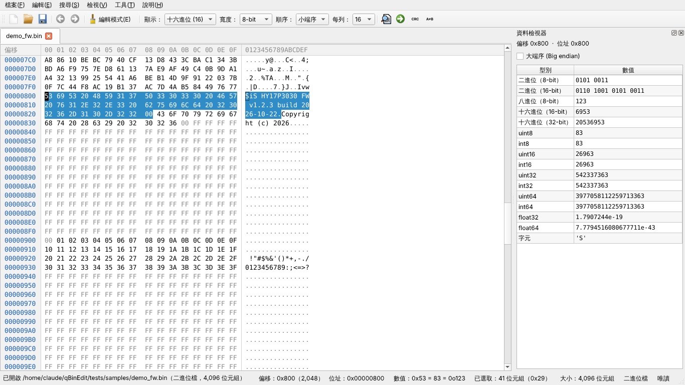
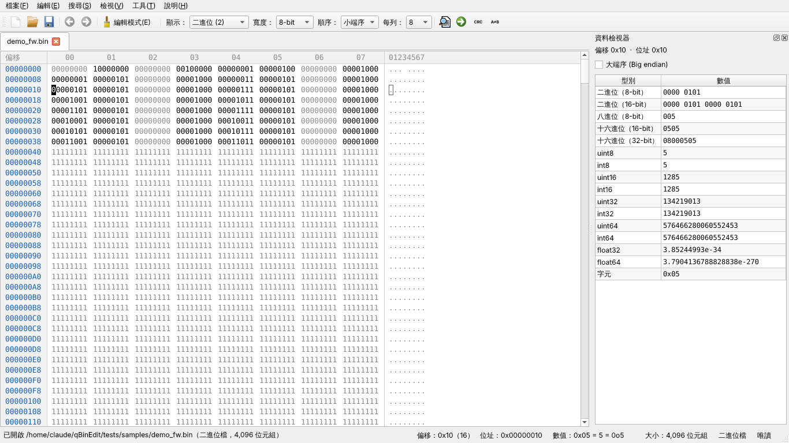
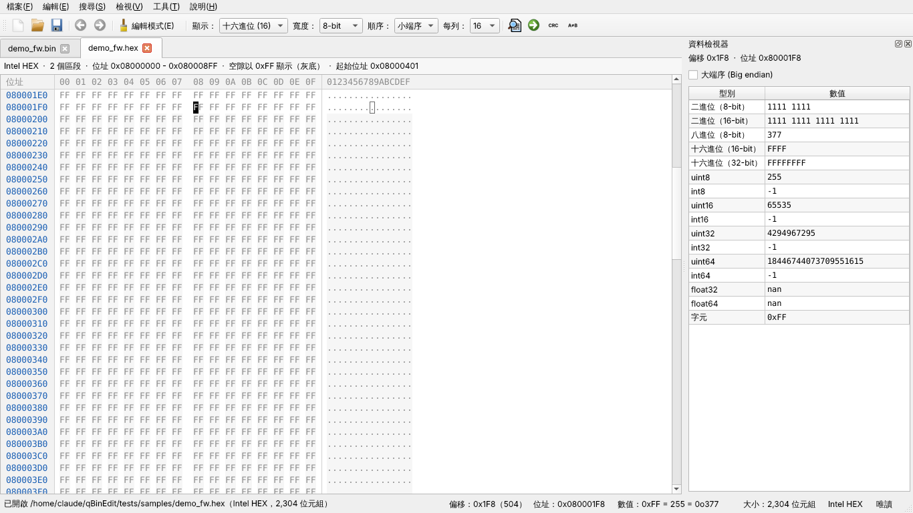
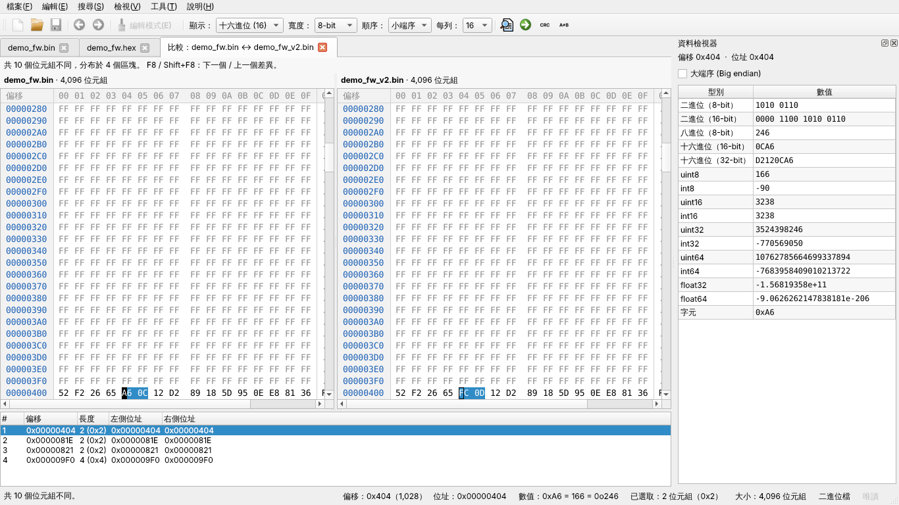

# qBinEdit — 韌體二進位檔檢視 / 編輯器

給韌體與嵌入式工程師用的 Windows 二進位檔檢視 / 編輯工具，以 Qt 6（C++17）開發，功能類似 UltraEdit 的十六進位模式，並針對韌體工作流程加強。

*A firmware binary viewer / editor for Windows (Qt 6, C++17) — see [English](#english) below.*



## 功能

- **顯示方式**：開檔後隨時切換 **2 進位 / 8 進位 / 16 進位**（Ctrl+1 / 2 / 3），資料寬度 **8 / 16 / 32-bit**（Alt+1 / 2 / 3），小端序 / 大端序
- **格式**：原始二進位、**Intel HEX**、**Motorola S-Record**（依位址展開、空隙標示、存回原格式或互轉）
- **編輯**：預設唯讀，Ctrl+E 進入編輯；覆寫、插入、刪除、填入、貼上，無限次復原
- **工具**：檢查碼 / CRC（Sum、XOR、CRC-8/16/32、STM32 CRC、Adler-32、MD5、SHA-1/256）、資料檢視器、兩檔比較（F8 跳差異）、十六進位 / ASCII / UTF-16 搜尋取代、跳至位址
- **介面**：繁體中文 / 英文（跟隨系統，可在「檢視 → 語言」切換）、深色模式、高 DPI
- **命令列**：`qBinEdit.exe [--radix 2|8|16] [--width 8|16|32] [--big-endian] [--raw] [--compare A B] [檔案...]`
- **隱私**：完全離線，不蒐集任何資料（[隱私權政策](PRIVACY.md)）

| 二進位顯示 | Intel HEX | 兩檔比較 |
|---|---|---|
|  |  |  |

## 下載

- **可攜版（免安裝）**：到 [Releases](https://github.com/chaoban/qBinEdit/releases) 下載 `qBinEdit-x.y.z-win64-portable.zip`，解壓後執行 `qBinEdit.exe`。
- **Microsoft Store**：上架後補上連結。
- 系統需求：Windows 10 1809 以上（64 位元）。

## 從原始碼編譯

**Windows（Qt 6.4 以上，MSVC 或 MinGW kit）**
```powershell
powershell -ExecutionPolicy Bypass -File scripts\build_windows.ps1 -QtDir C:\Qt\6.8.3\msvc2022_64
```
輸出 `dist\qBinEdit\`（程式資料夾）與 `dist\qBinEdit-<版本>-win64-portable.zip`。

**Linux 交叉編譯 Windows 版**（Releases 上的檔案即以此方式產生）
```bash
# 需要 MinGW-w64 (g++-mingw-w64-x86-64-posix)、以 MinGW 編譯的 Qt (QT_WIN) 與同版本 host Qt (QT_HOST)
QT_WIN=/opt/qt-win QT_HOST=/opt/qt-host tools/package_portable.sh
```

**Linux 原生（開發 / 測試）**
```bash
cmake -S . -B build -G Ninja && cmake --build build
build/qbe_tests && QT_QPA_PLATFORM=offscreen build/qbe_view_tests
```

**MSIX（Microsoft Store 套件）**：見 [docs/TESTING.md](docs/TESTING.md) 與 `packaging/msix/build_msix.ps1`。

## 專案結構

| 路徑 | 內容 |
|---|---|
| `src/` | 原始碼（`core/` 為不依賴 GUI 的格式解析與 CRC） |
| `tests/` | 單元測試與範例韌體檔 |
| `resources/` | 圖示、Logo、翻譯檔、Windows 版本資訊 |
| `packaging/msix/` | MSIX 範本、圖示資產與打包 / 測試 / 移除腳本 |
| `packaging/store/` | 商店圖示與截圖 |
| `docs/` | 商店上架文案、測試與移除說明 |
| `scripts/`、`tools/` | 編譯、打包、圖示產生、翻譯、截圖工具 |

## 翻譯
```bash
lupdate -no-obsolete -locations none src -ts resources/i18n/qbinedit_zh_TW.ts
python3 tools/fill_zh_tw.py          # 新字串請先加進 tools/fill_zh_tw.py 的對照表
lrelease resources/i18n/qbinedit_zh_TW.ts -qm resources/i18n/qbinedit_zh_TW.qm
```

## 授權

qBinEdit 依 [MIT 授權](LICENSE.txt) 發布，© 2026 SAISAI.Dev（aisais.dev@gmail.com）。
Qt 6 依 GNU LGPL v3 動態連結使用；其他第三方元件見 [THIRD-PARTY-NOTICES.txt](THIRD-PARTY-NOTICES.txt) 與 `licenses/`。

---

## English

qBinEdit is a binary viewer / editor for firmware and embedded engineers on Windows.

- Switch the display between **binary, octal and hexadecimal** at any time, with **8 / 16 / 32-bit** units in little or big endian
- Open, edit and save **Intel HEX** and **Motorola S-Record** at their real load addresses; convert to .bin
- Files open read-only; **Ctrl+E** enables editing with unlimited undo
- Checksums and CRCs (incl. STM32 hardware CRC), data inspector, side-by-side file compare, find / replace, go to address
- English and Traditional Chinese UI, dark mode, high-DPI; fully offline ([privacy policy](PRIVACY.md))

**Download** the portable ZIP from [Releases](https://github.com/chaoban/qBinEdit/releases). Requires Windows 10 1809 or later (64-bit).

**License:** [MIT](LICENSE.txt) © 2026 SAISAI.Dev. Qt 6 is used under the GNU LGPL v3; see [THIRD-PARTY-NOTICES.txt](THIRD-PARTY-NOTICES.txt).
